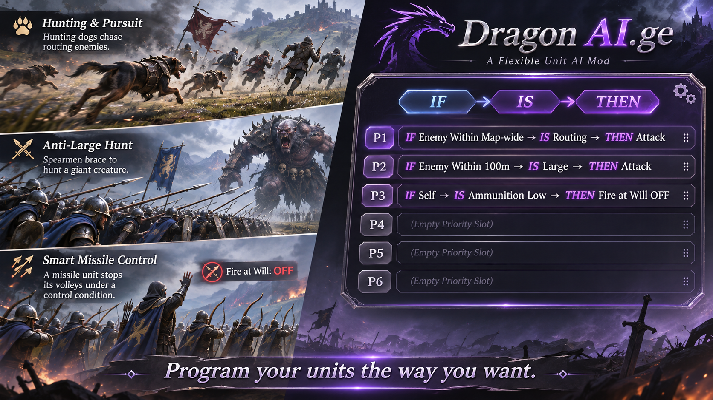
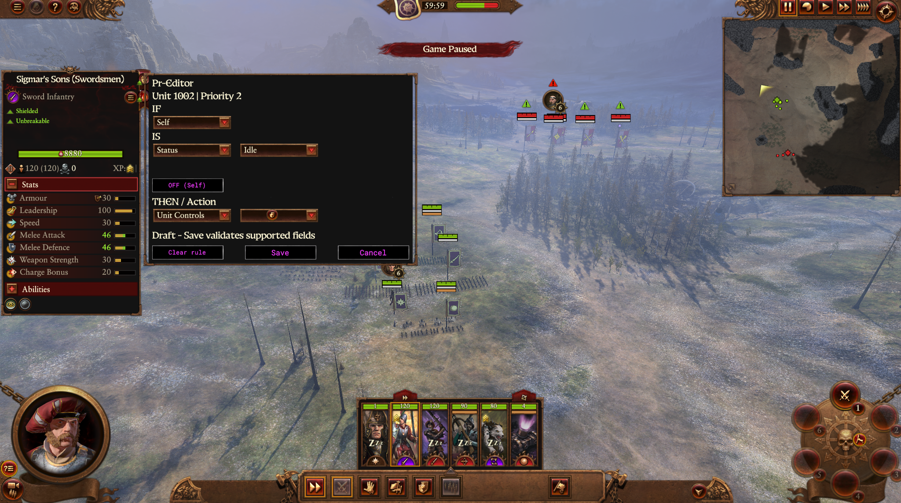
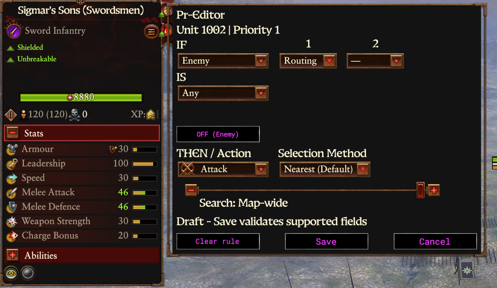

# Dragon AI.ge

**Programmable Battle AI for Total War: WARHAMMER III**

*In Development*

## About

Dragon AI.ge is a mod that lets you program how your units behave in battle.

Using a simple editor called Pr-editor, you can give units their own instructions, choose what they target, and decide how they respond to changing battlefield conditions.

Spend less time micromanaging and more time commanding your army.

## How It Works

Build your own tactical instructions using **IF → IS → THEN**.

- **IF:** When should the unit act?
- **IS:** What conditions must be met?
- **THEN:** What should the unit do?

Each unit can have up to **six prioritized instructions (P1–P6)**, allowing you to create everything from simple commands to more complex battlefield behaviour.

## In-Game Screenshots

Pr-editor running in battle, allowing unit instructions to be configured inside Total War: WARHAMMER III.

Create IF → IS → THEN rules and assign them to unit priorities.

### Your Army. Your Rules.

**Want hunting dogs that only chase routing enemies?**

`IF Enemy Within Map-wide → IS Routing → THEN Attack`

**Want spearmen dedicated to hunting giant creatures?**

`IF Enemy Within 100m → IS Large → THEN Attack`

**Want a missile unit to stop firing when a particular condition is met?**

`IF Self → IS Ammunition Low → THEN Fire at Will OFF`

You can do that with Dragon AI.ge.

**Program your units the way you want. As much as you want, or as little as you want.**

The system is being developed around:

- Conditional targeting and target selection.
- Prioritized orders and automatic transitions.
- Guarding, engagement and pursuit.
- Player control and command recovery.

## Roadmap

### What We've Done
- Built the core conditional programming and priority system.
- Developed targeting, Guard and command-handling systems.
- Established automated offline testing and source control.

### Before Release
- Finish and validate core behaviour in actual battles.
- Refine targeting, pursuit and command transitions.
- Improve the editor and overall usability.
- Test, fix bugs and prepare a stable release.

### After Release
- Saved unit programming across battles and campaigns.
- Automatic spellcasting and configurable use of magical abilities.
- Custom rules for when and how units use their special abilities and commands.
- Additional conditions, actions and tactical options.
- Community-requested features and ongoing improvements.

---

*Dragon AI.ge is an independent, unofficial mod for Total War: WARHAMMER III and is not affiliated with Creative Assembly, SEGA or Games Workshop.*
